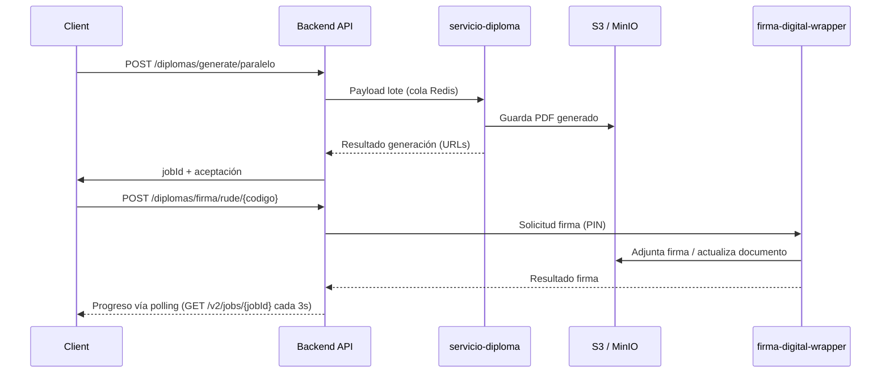
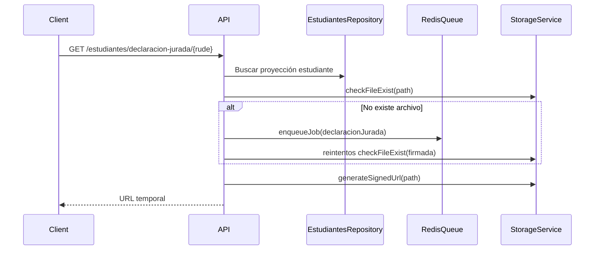

# Emisión de Diplomas de Bachiller Digital - DBD

# 4 Lecciones de Arquitectura de Software que Aprendimos

A primera vista, un sistema para gestionar y tramitar diplomas universitarios o escolares puede parecer un problema administrativo relativamente sencillo. Podríamos imaginarlo como un formulario web que recoge datos, genera un PDF y lo almacena en una base de datos. Una tarea de digitalización, sin más complicaciones. Sin embargo, al analizar la arquitectura de un sistema diseñado para esta tarea, descubrimos que detrás de esa aparente simplicidad se esconde una solución de software sorprendentemente robusta, moderna y escalable.

Lejos de ser una aplicación monolítica simple, el sistema revela un ecosistema de microservicios, un proceso 100% digital sostenido con estándares reales de seguridad de la información, y un enfoque de autorización flexible. Este diseño demuestra una profunda comprensión no solo de la tecnología, sino del complejo problema de negocio que resuelve.

Entonces, ¿qué lecciones de diseño, resiliencia y escalabilidad podemos extraer de un sistema bien diseñado? A continuación, exploraremos cuatro decisiones de arquitectura clave que lo convierten en un caso de estudio fascinante.

## 1. No es un Monolito: Es un Ecosistema de Servicios Especializados

La primera y más importante lección es que el sistema no fue concebido como una única y gran aplicación. En su lugar, es un conjunto de servicios independientes que colaboran, cada uno con una responsabilidad específica. Esta aproximación de microservicios es fundamental para su robustez.

El orquestador central es el Backend API REST (Puerto 3000), que gestiona toda la lógica de negocio del trámite, la validación de sus múltiples estados y la integración con el resto de los componentes. Sin embargo, las tareas pesadas o especializadas se delegan a otros servicios "worker" que actúan como expertos en su dominio, liberando a la API principal para que se mantenga ágil y receptiva. Los componentes clave incluyen:

* **servicio-diploma**: worker que concentra tres pipelines - generación masiva de diplomas en lote vía cola Redis, generación de certificaciones vía REST, e impresión en lote (ZIP por escuela/distrito) - tras consolidarse en diciembre de 2025 a partir de dos servicios separados que antes resolvían lo mismo por caminos distintos.
* **firma-digital-wrapper** (Puerto 7171): adaptador que envuelve una librería legada de firma digital (Jacobitus, PKCS#11/PKCS#12) para exponerla como una API moderna de firma PAdES.

Esta arquitectura de componentes es una decisión de diseño inteligente, ya que resuelve un reto de negocio clave: la necesidad de procesar lotes masivos y periódicos de diplomas (por ejemplo, al final de un semestre) sin colapsar las funcionalidades diarias de consulta y validación. Permite que cada parte del sistema escale de forma independiente; si la generación de diplomas se convierte en un cuello de botella, solo ese servicio necesita más recursos, no todo el sistema. Este ecosistema no se detiene en el backend; se complementa con una interfaz de usuario en Next.js, persistencia en PostgreSQL, almacenamiento de objetos en MinIO (S3 compatible) y Redis como el sistema nervioso central - y, desde mediados de 2026, con inicio de sesión mediante Ciudadanía Digital (AGETIC), la identidad digital nacional, para los roles ciudadanos.

## 2. Un Proceso 100% Digital, Sostenido por Estándares de Seguridad de la Información

Una decisión de diseño que distingue a este sistema de un simple trámite digitalizado es que **no existe fase física**: desde que se inicia el trámite hasta que el diploma es entregado y verificado, todo el ciclo de vida ocurre en línea. Una máquina de estados (PE → SU/VA → PR → PF → DF → EN, con RZ como rama de excepción) guía cada trámite de principio a fin sin que el documento pase por papel en ningún punto del proceso - ver la tabla completa más abajo.

Que un documento con validez legal viva íntegramente en formato digital no es un acto de fe: se sostiene sobre estándares concretos de seguridad de la información y confidencialidad, no sobre la promesa de que "nada va a fallar":

* **Integridad verificable**: cada acto administrativo crítico (por ejemplo, una derivación masiva de estudiantes) genera un respaldo en PDF inmutable cuyo hash SHA-256 se calcula sobre una representación canónica del acto - no sobre el PDF final - y se codifica en un código QR de verificación pública, evitando que el documento pueda alterarse sin que quede evidencia.
* **Firma digital con cadena de confianza**: la firma PAdES se aplica sobre tokens criptográficos (PKCS#11 hardware o PKCS#12 software) a través de `firma-digital-wrapper`, con validación de cadena de confianza y OCSP - exigida de forma estricta en producción y más permisiva solo en entornos de prueba.
* **Confidencialidad en sesión y en tránsito**: un único contrato de sesión JWT (HS256), con revocación de refresh tokens, y autorización granular por política (Casbin) evaluada en cada transición de estado, no solo al iniciar sesión.
* **Verificación pública sin exponer datos sensibles**: cualquier diploma firmado puede validarse desde un portal público a partir de su código QR, mostrando únicamente lo necesario para confirmar autenticidad.

Modelar el proceso de esta manera -digital de punta a punta, pero con garantías criptográficas en cada paso crítico- crea una única fuente de verdad auditable de extremo a extremo, sin los silos de datos ni los puntos ciegos que introduciría intercalar un tramo físico en el medio del flujo.

## 3. La Autorización es Dinámica, no Estática: El Poder de Casbin

La gestión de permisos en un sistema con múltiples roles -Director de Unidad Educativa (DIR), Director Distrital (DDIS), Responsable de Legalización (RESLEG), Director Departamental (DDEP), además de los Estudiantes (EST) que ingresan vía Ciudadanía Digital- puede volverse compleja rápidamente. Un enfoque común, pero rígido, es codificar las reglas directamente en la aplicación con sentencias como if usuario.rol == 'ADMIN'. Este sistema adopta una solución mucho más elegante y flexible.

En lugar de permisos estáticos, utiliza un enfoque de autorización basado en políticas a través de Casbin. Las reglas que definen quién puede hacer qué (por ejemplo, "un DDIS puede transicionar un trámite de VA a PR") no están en el código. Se gestionan como datos, definidos externamente en archivos como model.conf y policy.csv, y se persisten directamente en la base de datos en la tabla usuarios.casbin_rule.

La ventaja de este diseño es monumental. Si las políticas de la organización cambian y se necesita crear un nuevo rol o ajustar los permisos de uno existente, no es necesario modificar el código fuente de la aplicación ni realizar un nuevo despliegue. Los administradores pueden actualizar las políticas directamente en la base de datos, y los cambios se reflejan de inmediato. Esto proporciona una enorme flexibilidad y capacidad de adaptación a los cambios en los procesos de negocio.

## 4. Redis es Más que un Caché: El Motor de las Tareas Asíncronas

Para muchos desarrolladores, Redis es sinónimo de caché. Y si bien este sistema lo utiliza para ese propósito, su rol es mucho más multifacético. Según la documentación, Redis cumple tres funciones distintas: 1) Colas de trabajos diferidos, 2) Sincronización entre workers, y 3) Caché de sesiones y tokens. Su función más crítica en esta arquitectura es la primera: actuar como un intermediario de mensajes para tareas asíncronas. Cuando un usuario solicita una operación que puede ser lenta, como la generación de una declaración jurada, la API principal encola un trabajo en Redis (en la cola declaracion-juradajob) y responde inmediatamente al usuario, dándole feedback instantáneo. Un servicio worker independiente recoge el trabajo y lo procesa en segundo plano.

Este patrón no solo mejora la responsividad de la aplicación, sino que también aumenta la resiliencia del sistema. Si la generación de un PDF falla temporalmente, el trabajo permanece en la cola para ser reintentado automáticamente, sin intervención manual y sin que el usuario final se vea afectado. Al delegar tareas pesadas a colas procesadas por workers, la API principal se mantiene ligera, rápida y receptiva, incluso bajo una carga de trabajo intensa. Esto evita que los usuarios experimenten largos tiempos de espera y mejora la estabilidad general, ya que los picos de trabajo se absorben en las colas en lugar de sobrecargar la API.

## Conclusión

El análisis de este sistema de trámite de diplomas demuestra que la buena ingeniería de software se puede encontrar en los lugares más inesperados. Lo que podría haber sido una simple aplicación CRUD es, en realidad, un ejemplo de arquitectura desacoplada, modelado preciso de procesos y diseño flexible. Nos enseña que la complejidad de un sistema no proviene de la tecnología que utiliza, sino de la profundidad con la que entiende y resuelve un problema del mundo real. La próxima vez que te enfrentes a un proyecto, pregúntate: ¿qué procesos del mundo real podrías modelar con mayor precisión o qué componentes podrías desacoplar para construir un sistema más robusto y flexible?

## Evolución del Proyecto: de CRUD Convencional a Plataforma Distribuida

Este sistema lleva más de 15 meses en desarrollo activo, repartidos en 5 repositorios independientes (`diploma-backend`, `diploma_frontend`, `servicio-diploma`, `firma-digital-wrapper-java`, `diplomas-ansible`) que suman más de 1.600 commits. La línea de tiempo es, en sí misma, un caso de estudio sobre cómo madura un sistema real bajo requisitos gubernamentales cambiantes:

| Fase | Periodo | Hito |
|------|---------|------|
| **CRUD convencional** | Jul–Oct 2025 | Backend Spring Boot básico, entidades, JWT simple. El generador de diplomas vive como un módulo monolítico, sin cola ni worker. |
| **Desacoplamiento** | Nov–Dic 2025 | Se introduce Redis como cola de trabajos; el 3 de diciembre de 2025 se divide el generador en una arquitectura cliente/worker - el primer salto arquitectónico real. Se incorpora Casbin (RBAC por políticas). |
| **Hardening silencioso** | Ene–Abr 2026 | Fase de bajo volumen de commits: diseño y validación de requisitos para la integración con el SSO nacional. |
| **SSO nacional (Strangler Fig)** | May 2026 | `v1.45.0` - Integración de **Ciudadanía Digital (AGETIC)** conviviendo con el login legado. Empiezan los ADRs como práctica formal (11 ADRs en frontend, 12 en backend, 1 en el worker). |
| **Producción responsable** | Jun–Ago 2026 | Ceremonia de confirmación con PDF inmutable (ADR-0011), mecanismo de pruebas de carga (ADR-001) que expone fallos silenciosos reales, cacería sistemática de bugs de estado documentada con causa raíz en `CLAUDE.md`. |
| **Simplificación de infraestructura** | Sep–Oct 2026 | Eliminación de WebSocket en favor de polling (ADR-0012), migración de registro de contenedores a Nexus, cluster de 4 nodos provisionado con Ansible (`datos`, 2× `worker`, `edge`) reemplazando el despliegue manual/piloto. |

A lo largo de todo este recorrido, el stack de herramientas de desarrollo también maduró: 5 *skills* de Claude Code compartidos entre los repos Java (`code-quality`, `design-patterns`, `jpa-patterns`, `logging-patterns`, `spring-boot`), un `CLAUDE.md` por repositorio que funciona como bitácora de ingeniería fechada, y hasta un agente de IA opcional (Spring AI) embebido en el worker de PDFs para autodiagnóstico de errores.

### Arquitectura completa del ecosistema


El diagrama resume el flujo real de punta a punta: el frontend Next.js autentica contra el login legado o, para roles ciudadanos, contra Ciudadanía Digital (AGETIC); el backend orquesta la cola Redis hacia `servicio-diploma` y las llamadas REST hacia `firma-digital-wrapper`; y toda la capa corre sobre el clúster de 4 nodos que provisiona `diplomas-ansible` (ver el [proyecto de infraestructura](/#/projects/diplomas-infra) dedicado a esa parte del sistema).

## Lecciones de Producción (no solo de diseño)

Más allá de la arquitectura inicial, la parte más valiosa de este proyecto son los errores reales encontrados - y corregidos - en producción. Cuatro ejemplos concretos:

**1. Integrar un SSO nacional sin romper el sistema legado.** La migración a Ciudadanía Digital no reemplazó el login existente: convivió con él detrás de un único contrato de sesión (un solo JWT interno HS256, sin importar el origen del login), siguiendo el patrón *Strangler Fig*. El `auth_method` quedó como metadato informativo, nunca como condición de negocio, evitando bifurcar la lógica de aprobación en dos caminos distintos.

**2. Un guion bajo rompió el 100% de las notificaciones, sin dejar rastro en los logs.** Durante las pruebas de carga se descubrió que las notificaciones del worker de PDFs al backend fallaban siempre con HTTP 400 - pero no había ninguna evidencia en los logs de la aplicación. La causa: el nombre del servicio en Docker Compose (`diploma_backend`) contenía un guion bajo, y el conector HTTP de Tomcat rechaza *hostnames* con guion bajo por RFC 1123, **antes** de que la petición llegue a cualquier filtro de Spring. Se corrigió con alias de red con guiones en Ansible. Lección generalizable: cualquier servicio Java/Tomcat detrás de Docker Compose puede sufrir este mismo fallo silencioso.

**3. "La cola vacía" no es prueba de éxito.** El mecanismo original de pruebas de carga asumía que una cola Redis vacía significaba que todos los trabajos se habían completado. La realidad, documentada en el ADR-001: el worker confirmaba (`ack`) el trabajo incluso cuando la generación fallaba, porque las excepciones se capturaban sin relanzarse. Se corrigió midiendo la verdad de referencia real - contar los PDFs que efectivamente existen en el almacenamiento S3 - en lugar de confiar en el estado de la cola. Con esa corrección, las pruebas midieron ~225 diplomas/minuto (20 hilos en 2 nodos), cumpliendo el requisito de ≤30 min para 500 diplomas.

**4. Eliminar WebSocket fue una mejora, no un paso atrás.** El seguimiento de progreso en tiempo real usaba WebSocket (STOMP) desde las primeras versiones. En producción, dos problemas de infraestructura lo rompían: un proxy corporativo que descartaba el header `Upgrade`, y un balanceador *round-robin* sin sesiones pegajosas que perdía mensajes del broker en memoria entre instancias. La solución (ADR-0012) fue reemplazar WebSocket por *polling* cada 3 segundos contra el estado persistido en Redis - menos elegante en el papel, pero el único enfoque que sobrevive a un despliegue horizontal real detrás de un proxy que no controlas.

Servicio Spring Boot para la gestión integral de trámites de diplomas, procesamiento de declaraciones juradas, carga y validación documental, generación masiva y distribución segura de archivos firmados. Incluye autorización basada en políticas (Casbin) y autenticación JWT, trabajos enviados a Redis, persistencia en PostgreSQL/JPA y almacenamiento en S3. 

## Resumen Funcional
- Gestión de bandejas, estados del trámite.
- Generación on-demand de Declaración Jurada con reintentos asíncronos vía Redis.
- Procesamiento masivo de diplomas mediante servicio worker externo y empaquetado ZIP.
- Almacenamiento de archivos en MinIO (S3 compatible, auto alojado).
- Sistema de estados y transición controlada (observados, rezagados, completos, generados).
- Notificaciones por correo con plantillas HTML.
- Documentación OpenAPI automática (SpringDoc).

## Requisitos Técnicos

| Componente | Mínimo | Recomendado |
|------------|--------|-------------|
| Java | 21 | 21 Temurin LTS |
| Maven | 3.9.x | 3.9.9 |
| PostgreSQL | 13 | 14+ |
| Redis | 6.2 | 7.2+ (Lettuce) |
| S3 compatible | MinIO | MinIO / AWS S3 |
| Docker | 24.0 | 26.x |
| SO | Ubuntu 24.04+ | Ubuntu 24.04 LTS / Debian 13 |

### Stack y Versiones (pom.xml)

| Componente | Versión | Notas |
|------------|---------|-------|
| Spring Boot | 3.5.10 | Web MVC, WebFlux, Data JPA, Security, Redis, Actuator, Mail |
| PostgreSQL Driver | 42.7.8 | JDBC driver para PostgreSQL |
| Redis client | - | Lettuce + `commons-pool2` |
| Casbin (jcasbin) | 1.85.1 | Autorización basada en políticas |
| Casbin JDBC Adapter | 2.10.0 | Persistencia de reglas en BD |
| Casbin Spring Boot Starter | 1.9.0 | Integración y auto-configuración |
| JWT (JJWT) | 0.13.0 | Módulos API / Impl / Jackson |
| AWS SDK v2 | 2.38.3 | S3 + `url-connection-client` |
| SpringDoc OpenAPI UI | 2.8.14 | Documentación OpenAPI/Swagger |
| Lombok | - | Solo compile-time (administrado por Spring Boot) |
| JavaFaker | 1.0.2 | Datos de prueba |
| JaCoCo | 0.8.12 | Cobertura de pruebas |

## Arquitectura

### Estructura de Capas (Código)
```
src/main/java/com/minedu/planificacion/diploma/diploma_backend/
├── presentation/      # Controladores REST, DTO externos, manejo de errores
├── application/       # Servicios orquestadores, listeners, lógica de casos de uso
├── domain/            # Modelos, enums, eventos, interfaces (ports)
├── infrastructure/    # Adaptadores: JPA, Redis, S3, HTTP, seguridad, scheduling, email
├── helpers/           # Utilidades específicas de negocio
├── shared/            # Utilidades transversales (fechas, ZIP, excepciones comunes)
└── DiplomaBackendApplication.java
```

### Generación y Firma de Diploma


### Declaración Jurada On-Demand


### Despliegue


Desde septiembre de 2026 el despliegue ya no es manual ni un cluster piloto: `diplomas-ansible` provisiona un clúster distribuido de 4 nodos agentless por SSH -`edge` (nginx con TLS/SNI, Grafana, Prometheus), dos nodos `worker` (cada uno con `diploma-backend`, `servicio-diploma` y `firma-digital-wrapper`) y `datos` (PostgreSQL + PgBouncer, Redis, MinIO)-, con secretos por entorno vía `ansible-vault` y promoción de entornos por tag de git, nunca por rama. Detalle completo en el [proyecto de infraestructura](/#/projects/diplomas-infra).

### DESCRIPCIÓN DE SERVICIOS DEL SISTEMA

El Sistema de Diplomas Digitales se compone de varios servicios independientes. Cada uno cumple una función específica dentro del proceso de registro, validación, generación, firma digital y almacenamiento de documentos.

A continuación se describe la estructura de los servicios involucrados:

**1. Backend API (Puerto 3000)**
Servicio principal, expone la API REST utilizada por los actores del sistema.
Funciones:
- Gestión del trámite estudiantil.
- Validación de documentos y control de estados.
- Gestión de periodos.
- Integración con servicios externos.

**2. Frontend Web**
Interfaz de usuario desarrollada en Next.js, con dos mecanismos de login convivendo tras un único contrato de sesión (JWT interno HS256): usuario/contraseña para roles internos, y OAuth2 contra **Ciudadanía Digital (AGETIC)** para roles ciudadanos.
**Usuarios (roles actuales):**
- DIR - Director de Unidad Educativa.
- DDIS - Director Distrital.
- RESLEG - Responsable de Legalización.
- DDEP - Director Departamental.
- EST - Estudiante (desde 2026 acceso vía Ciudadanía Digital).
**Funciones:**
- Seguimiento del trámite y bandejas de revisión por rol.
- Derivación y aprobación con ceremonia de confirmación (respaldo PDF inmutable para acciones irreversibles).
- Envío a firma y descarga/verificación pública de diplomas.

**3. servicio-diploma (worker)**
Consolidado en diciembre de 2025 a partir de dos servicios separados. Concentra tres pipelines independientes:
- Generación masiva de diplomas en lote, consumida desde la cola Redis del backend.
- Generación de certificaciones, vía REST directo (202 Accepted + jobId).
- Impresión en lote (texto plano sin QR, para papel pre-impreso), empaquetada en ZIP por escuela/distrito.

**4. firma-digital-wrapper (Puerto 7171)**
Adaptador sobre la librería legada Jacobitus (tokens PKCS#11/PKCS#12):
- Firma PAdES síncrona, remota y por lote asíncrono.
- Validación de firmas PAdES existentes (cadena de confianza, OCSP, configurables por entorno).
- Verificación de firma con token físico como respaldo de autorización (RESLEG).

**5. Base de Datos PostgreSQL (Puerto 5432)**
La base de datos tiene los siguientes esquemas:
- usuarios
- operativo
- parametricas
- certificaciones
- sie_fdw (conexión remota de solo lectura a la base de datos del SIE)

**6. Redis (Puerto 6379)**
Usado para:
- Colas de trabajos diferidos.
- Sincronización entre workers.
- Caché de sesiones y tokens.
- Estado de progreso de jobs consultado por polling (reemplazó al canal WebSocket, ver ADR-0012).

**7. Almacenamiento S3 (Puerto 9000)**
Almacena:
- PDFs finales de diplomas.
- Fotografías
- Documentación adjunta
- Archivos temporales y ZIPs

**8. Ciudadanía Digital (AGETIC) - dependencia externa**
Identidad digital nacional, integrada vía OAuth2 para los roles ciudadanos (EST), con un segundo factor (*step-up*) exigido antes de acciones críticas de aprobación.

**9. diplomas-ansible - aprovisionamiento**
No es un servicio de aplicación, sino la capa que aprovisiona y despliega todos los anteriores sobre un clúster de 4 nodos. Desarrollo propio, documentado como [proyecto de infraestructura](/#/projects/diplomas-infra) independiente.


## Seguridad
- Autenticación JWT HS256, único contrato de sesión sin importar el origen del login (filtros personalizados para emisión y validación).
- Doble mecanismo de login: usuario/contraseña (roles internos) y OAuth2 contra **Ciudadanía Digital/AGETIC** (roles ciudadanos), unificados detrás del mismo JWT.
- Segundo factor (*step-up*) contra Ciudadanía Digital exigido antes de acciones críticas de aprobación (p. ej. DDIS transicionando VA→PR).
- Autorización con Casbin (`model.conf`, `policy.csv`) y tabla `usuarios.casbin_rule`.
- Refresh tokens persistidos (tabla `usuarios.refresh_tokens`) con revocación y limpieza programada.

## Configuración (application.properties) – Variables Recomendadas
| Variable | Descripción | ENV |
|----------|-------------|---------------|
| `spring.datasource.*` | Conexión PostgreSQL principal | Sí |
| `spring.data.redis.*` | Host/puerto Redis | Sí |
| `app.s3.*` | Credenciales y endpoint S3 | Sí |
| `jwt.secret` | Clave firma JWT | Sí |
| `app.token` | Token integración API Core | Sí |
| `spring.mail.*` | SMTP credenciales | Sí |
| `app.jacobitus.*` | Firma externa Jacobitus | Sí |


## Estados del Trámite

Esta tabla refleja la máquina de estados vigente, documentada formalmente en el **ADR-0004** (backend y frontend). Reemplaza un diseño anterior con más estados y transiciones manuales - simplificado deliberadamente en junio de 2026 ("flujo-demo-2") al eliminar un estado intermedio (`INICIADO`) que no aportaba valor al flujo real.

| Código | Nombre | Propietario de la transición |
|--------|--------|-------------------------------|
| PE | Pendiente | Estado inicial del trámite |
| SU | Subsanación | Rama alterna - requiere corrección de datos/documentos |
| VA | Validado | **SIE** (sistema nacional de información estudiantil) confirma los datos académicos |
| PR | Pre-aprobado | **DDIS** transiciona de VA → PR |
| PF | Pendiente de Firma | **RESLEG** transiciona de PR → PF |
| DF | Diploma Firmado | Firma digital aplicada (`firma-digital-wrapper` / Jacobitus) |
| EN | Entregado | Estado final - diploma disponible para el estudiante |
| RZ | Rezagado | Rama de excepción, aplicable desde los estados tempranos del trámite |

Las transiciones manuales que antes exponía la API para forzar un cambio de estado fueron deliberadamente desactivadas (**ADR-0005**, devuelven HTTP 410 Gone) una vez que SIE pasó a ser el propietario real de VA. Es un patrón reutilizable: en vez de borrar un endpoint en silencio o dejarlo devolviendo un 404 genérico, un 410 explícito documenta que el endpoint existió, y por qué dejó de estar disponible.

El estado `EN` (Entregado) es el cierre del ciclo: el diploma firmado queda disponible digitalmente para el estudiante, verificable públicamente por QR, sin un tramo de distribución física posterior.

## Construcción y Ejecución

### Maven Local
```bash
./mvnw clean verify
./mvnw spring-boot:run
```
Swagger: `http://localhost:3000/swagger-ui.html` | Health: `http://localhost:3000/actuator/health`

### Imagen Docker (Multi-stage con Temurin 21)
```bash
docker build -t diploma-backend:latest .
docker run -p 5000:5000 --env-file env.list diploma-backend:latest
```
Variables sensibles deben ir en `env.list` o secretos gestionados.

### docker-compose
Configurar servicio junto a PostgreSQL/Redis/MinIO en `docker/docker-compose.yml` (agregar perfiles o variables faltantes).

## Redis y Jobs Diferidos
Cola `declaracion-juradajob` para generación diferida. Prefijo y patrón configurables (`app.queue.key.*`). Ajustar TTL y políticas de retry según carga real.

## Firma Digital
Integración con el servicio de firma Digital (`app.jacobitus.api.firma.lote`).
