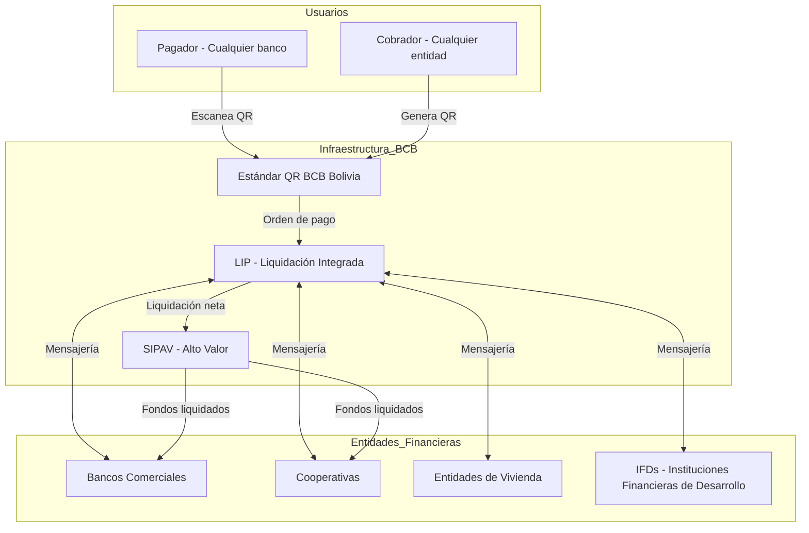
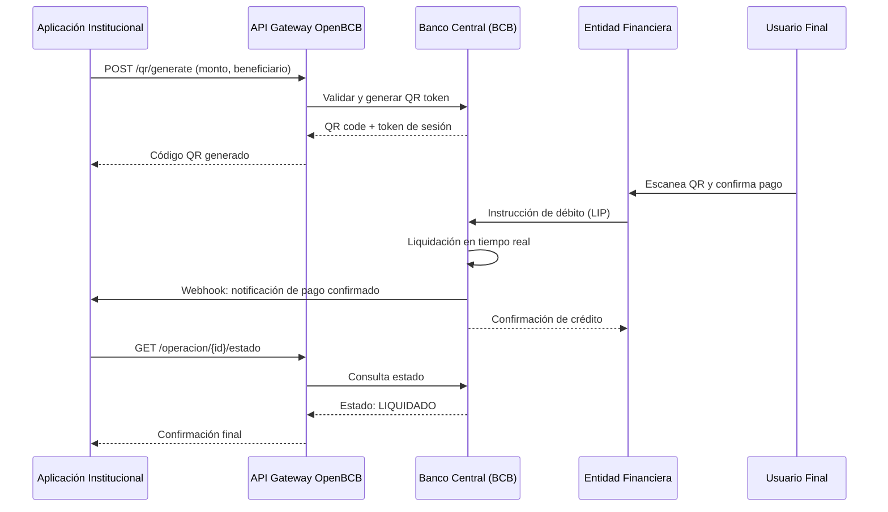
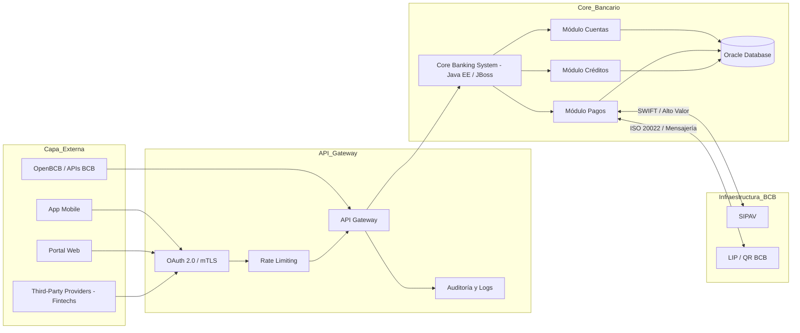
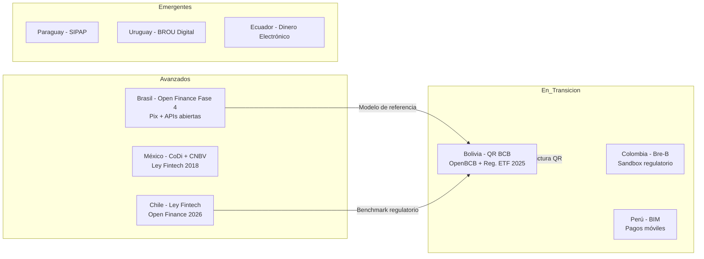

## Open Banking en Bolivia: De la Banca Tradicional a la Era de las APIs
 
### Introducción
 
Bolivia se encuentra en un punto de inflexión en su historia financiera. Durante décadas, el sistema bancario del país operó bajo una lógica de silos: cada banco, cooperativa y entidad financiera gestionaba sus datos de forma aislada, con sistemas legados robustos pero cerrados, sin capacidad de interoperar de manera abierta con terceros.
 
El **Open Banking** —la filosofía de abrir los datos financieros del cliente a terceros autorizados mediante APIs seguras— llega a Bolivia en un momento en que la infraestructura ya está madurando. La masificación del QR interoperable, el lanzamiento de OpenBCB por parte del Banco Central, y la aprobación del marco regulatorio para Empresas de Tecnología Financiera (ETF) en 2025 son señales claras de que el país está transitando de un modelo cerrado hacia uno abierto, interconectado y orientado al consumidor.
 
Este case study explora cómo funciona la infraestructura financiera boliviana, los avances en Open Banking, los desafíos técnicos que implica modernizar un Core Bancario y el papel que juegan las APIs en la transformación del ecosistema fintech nacional.
 
---
 
## Los 4 Pilares del Open Banking en Bolivia
 
### 1. La Infraestructura Base: SIPAV, LIP y el Ecosistema de Pagos
 
Antes de hablar de Open Banking, es indispensable comprender la infraestructura sobre la que se construye. El Banco Central de Bolivia (BCB) opera dos sistemas críticos que forman la columna vertebral de los pagos nacionales:
 
El **SIPAV (Sistema de Pagos de Alto Valor)** procesa transacciones de gran envergadura en tiempo real —liquidaciones interbancarias, operaciones del mercado de valores y pagos entre instituciones financieras—. Es el corazón del sistema financiero, donde los errores no tienen margen de tolerancia.
 
El **LIP (Sistema de Liquidación Integrada de Pagos)** es el mecanismo a través del cual todas las entidades con cuenta en el BCB —bancos, cooperativas, entidades financieras de vivienda— procesan sus órdenes de pago de bajo valor. Su obligatoriedad garantiza que ningún actor del sistema quede fuera de la red.
 
Esta arquitectura dual —alto valor en tiempo real + bajo valor por lotes— es la base sobre la que se implementan los productos digitales modernos. Trabajar con estos sistemas implica comprender profundamente los protocolos de mensajería financiera, los ciclos de liquidación y los mecanismos de contingencia que garantizan la disponibilidad 24/7.
 
### 2. El Punto de Quiebre: QR BCB Bolivia y la Interoperabilidad Forzada
 
El hito más significativo en la modernización del sistema de pagos boliviano fue la implementación del **estándar QR BCB Bolivia**. A diferencia de otros países donde cada banco desarrolló su propio QR (generando fragmentación), el BCB tomó una decisión regulatoria audaz: establecer un estándar único y obligatorio para todo el sistema financiero.
 
El resultado fue transformador. Un usuario del Banco Mercantil puede pagar a un comerciante que cobra a través de una cooperativa rural, usando el mismo código QR. Esta interoperabilidad total, que en Brasil tomó años lograr con Pix, Bolivia la implementó por mandato regulatorio.
 
Los números validan el impacto: entre 2021 y 2024, el valor de las operaciones por QR se **multiplicó por 48**, pasando de Bs 3.195 millones a Bs 156.926 millones. Solo en enero de 2025, los pagos QR representaron el **27% del total de órdenes electrónicas de transferencia** del sistema financiero boliviano. Y todo esto en un país con el 80% de informalidad laboral según la OIT.
 

 
### 3. OpenBCB: El Primer Paso Hacia las APIs Financieras Abiertas
 
En octubre de 2025, el BCB presentó **OpenBCB**, una plataforma de APIs gratuita diseñada para resolver un problema concreto: miles de instituciones públicas y privadas aún no habían podido automatizar su gestión de cobranza por limitaciones presupuestarias o técnicas.
 
OpenBCB democratiza el acceso a la infraestructura financiera digital mediante cuatro funcionalidades clave:
- **Generación gratuita de códigos QR** mediante API
- **Consulta del estado de operaciones** en tiempo real
- **Procesamiento ágil de órdenes de pago** vía integración directa
- **Notificación automática de transacciones** sin costo
 
Esta plataforma es, en esencia, la primera implementación de Open Banking impulsada directamente desde el banco central. No es solo una API de pagos: es un modelo de soberanía tecnológica que pone la infraestructura financiera al servicio de la inclusión, priorizando zonas periurbanas y rurales donde los desafíos de conectividad y bancarización son mayores.
 

 
### 4. El Marco Regulatorio ETF: El Ecosistema se Formaliza
 
El Decreto Supremo N° 5384 (mayo 2025) y el posterior Reglamento de la ASFI para Empresas de Tecnología Financiera (ETF) representan el cambio más profundo en el marco legal del sector desde la Ley 393 de Servicios Financieros de 2013.
 
Más de **40 empresas fintech** operaban en Bolivia —principalmente en Santa Cruz, Cochabamba y La Paz— sin un marco legal claro. Con la nueva regulación, todas deben obtener autorización de la ASFI antes del 31 de diciembre de 2025. Las ETF pueden operar en cinco áreas: blockchain y activos tokenizados, sistemas de pagos, plataformas de financiamiento, tecnologías empresariales, y nuevas categorías que defina la ASFI.
 
Paralelamente, en septiembre de 2024, Raidiam —empresa especialista en Open Banking— capacitó a 60 altos ejecutivos de ASFI, el Ministerio de Economía y Finanzas Públicas, bancos y fintechs en La Paz. La capacitación abordó fundamentos, consideraciones regulatorias, estructuras de mercado y mejores prácticas internacionales. La ASFI recibió un informe detallado con recomendaciones y al cierre de 2025 evaluaba cómo avanzar hacia una regulación específica de Open Banking con APIs abiertas al estilo de Brasil o Chile.
 
---
 
## Arquitectura Técnica: El Core Bancario en el Contexto Open Banking
 
Integrar un Core Bancario tradicional con la nueva capa de Open Banking no es una tarea trivial. Los sistemas legados —construidos sobre Java EE, Oracle DB, JBoss/WildFly y servidores RedHat— fueron diseñados para operar en redes cerradas con transacciones síncronas. Exponerlos a través de APIs requiere una capa de abstracción cuidadosamente diseñada.
 

 
### Desafíos Técnicos Clave
 
**Mensajería y Estándares**: Los sistemas de pago del BCB operan con estándares de mensajería financiera propios. La integración con el Core Bancario requiere transformaciones de formato, manejo de timeouts estrictos y mecanismos de compensación para transacciones fallidas.
 
**Seguridad y Autenticación**: El Reglamento para la Gestión de Seguridad de la Información de la ASFI exige controles rigurosos. En un modelo Open Banking, esto se traduce en implementar OAuth 2.0 con PKCE, mTLS para comunicaciones entre entidades, y Row Level Security en la capa de datos para garantizar que cada TPP (Third-Party Provider) solo acceda a la información autorizada explícitamente por el cliente.
 
**Alta Disponibilidad**: Los sistemas de pago no pueden caer. La arquitectura sobre RedHat Enterprise Linux con clustering JBoss/WildFly proporciona la resiliencia necesaria, pero la transición hacia APIs REST expuestas al público exige añadir capas de rate limiting, circuit breakers y estrategias de degradación elegante.
 
**Reconciliación**: Con múltiples canales (QR, transferencia, API directa) convergiendo al mismo Core, los procesos de reconciliación nocturna se vuelven críticos. Oracle Database sigue siendo el motor de elección para gestionar la consistencia transaccional en entornos de alta carga.
 
---
 
## Bolivia en el Mapa Regional del Open Banking
 

 
Bolivia no lidera el ranking regional, pero su posición es más sólida de lo que parece. La interoperabilidad universal del QR —que en Brasil requirió años de negociación con los grandes bancos— aquí fue impuesta por el BCB desde el inicio. OpenBCB es una apuesta de soberanía tecnológica: en lugar de depender de plataformas privadas, el banco central provee la infraestructura de forma gratuita. Y el marco regulatorio ETF de 2025 crea, por primera vez, un terreno legal estable para que las fintechs escalen.
 
---
 
## Stack Tecnológico
 
El trabajo en infraestructura financiera boliviana combina tecnologías empresariales consolidadas con herramientas modernas de integración:
 
* **Backend Core**: Java EE, Spring Boot, JBoss / WildFly (RedHat)
* **Base de Datos**: Oracle Database (transaccional, alta disponibilidad)
* **Mensajería Financiera**: Protocolos BCB (LIP/SIPAV), ISO 20022
* **Seguridad**: OAuth 2.0, mTLS, LDAP corporativo, HSM para firma digital
* **Infraestructura**: RedHat Enterprise Linux, clustering activo-activo
* **Integración**: REST APIs, SOAP (sistemas legados), colas JMS
* **Monitoreo**: Prometheus, Grafana, ELK Stack para auditoría de transacciones
 
---
 
## Conclusión: El Momento de Bolivia
 
El Open Banking no llega a Bolivia de golpe. Llega de forma incremental, construida sobre una infraestructura de pagos que silenciosamente se volvió una de las más interoperables de la región. El QR BCB ya demostró que la interoperabilidad masiva es posible. OpenBCB demuestra que las APIs financieras abiertas son viables desde el sector público. El marco ETF 2025 demuestra que existe voluntad regulatoria de formalizar el ecosistema.
 
Lo que falta —una regulación específica de Open Banking con estándares de APIs abiertas, consentimiento del cliente y terceros acreditados— es el siguiente capítulo. La ASFI tiene los insumos: el entrenamiento de septiembre 2024, el reporte de Raidiam y los modelos de Brasil y Chile como referencia. El ecosistema fintech boliviano, con más de 40 empresas activas y una comunidad vibrante, está listo para recibirlo.
 
Para los ingenieros que trabajan en este sector, el reto es fascinante: conectar décadas de infraestructura Java/Oracle con el mundo de las APIs REST abiertas, sin interrumpir ni por un segundo los sistemas que mueven millones de bolivianos cada día.
